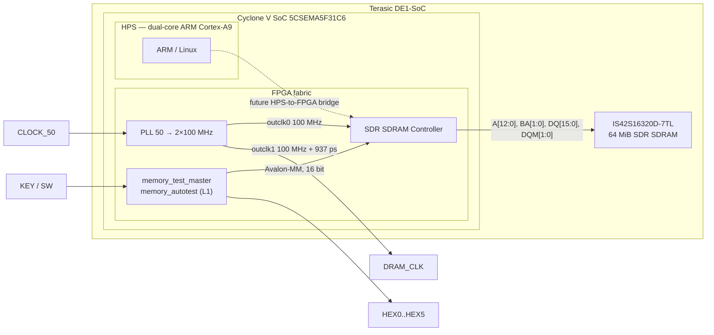

# Vision Core

**Потоковая FPGA-фильтрация изображений в реальном времени — Vision Core на Terasic DE1-SoC.**


Vision Core — учебно-инженерный прототип: FPGA автономно выполняет захват, буферизацию и нейтральные операции над изображениями (фильтрация, градиенты, пороги, морфология), а ARM (HPS) получает готовые данные и отвечает за предметную интерпретацию — размеры, дефекты, классификацию. Яблоки — первый учебный объект; платформа не привязана к конкретному прикладному сценарию.

**Незыблемая цель:** потоковая фильтрация изображений в FPGA в реальном времени (свёртка, градиенты, пороги, морфология); захват, буферизация и HPS-интерпретация — обеспечивающие слои; L1–L5 проверяют память и не заменяют фильтрацию.

> **Статус: ранний прототип.** SDRAM работает на 100 МГц; ручной тест и L1 (шина данных `DQ[15:0]`) пройдены. L2–L5, камера, HPS и функциональная симуляция — впереди.

---

## Содержание

- [Что уже работает](#что-уже-работает)
- [Архитектура](#архитектура)
- [Аппаратная платформа](#аппаратная-платформа)
- [Быстрый старт](#быстрый-старт)
- [Проверка и результаты](#проверка-и-результаты)
- [Структура репозитория](#структура-репозитория)
- [Дорожная карта](#дорожная-карта)
- [Документация](#документация)
- [Происхождение RTL и лицензия](#происхождение-rtl-и-лицензия)

---

## Что уже работает

- **64 МиБ SDR SDRAM** (`IS42S16320D-7TL`, 32M×16, 3.3 В) на стороне FPGA — кандидат на кадровую память.
- **100 МГц** тактовая частота памяти; PLL формирует `outclk0` (контроллер) и `outclk1` (`DRAM_CLK`) со сдвигом **937 ps**.
- **Ручной тест**: запись/чтение `A5A5` по адресам `0x1F0000..0x1F03FF`; шаги 1–6 пройдены.
- **Автотест L1**: 34 паттерна (16 walking-1, 16 walking-0, `0000`, `FFFF`) на `0x1F0300`; все 16 линий `DQ[15:0]` исправны.
- **Сборка и тайминг**: полная сборка Quartus 25.1std, TNS 0; худшие углы hold `+0.048 нс`, removal `+0.131 нс`.
- **Управление**: `KEY1`/`KEY2` — ручная запись/чтение, `KEY3` — запуск автотеста, `KEY0` — сброс.

Пока не сделано: L2–L5, приём камеры, обмен с HPS, функциональная симуляция и окончательный SDRAM I/O sign-off.

---

## Архитектура



- **Контроллер памяти** — Altera SDR SDRAM Controller 14.0 с фиксированными таймингами; refresh reload 780 под 100 МГц.
- **Reset-схема**: внешний сброс и потеря захвата PLL объединяются; снятие сброса синхронизируется в домене контроллера.
- **Тестовые мастера**: `memory_test_master` (ручной режим) и `memory_autotest` (L1) подключены к Avalon-MM slave; управления из HPS пока нет.
- **`memory_subsystem`** сгенерирована в Platform Designer; исходники в репозитории, сгенерированные каталоги — нет.

Подробное обоснование решений — в [TECHNICAL_REPORT.md](TECHNICAL_REPORT.md).

---

## Аппаратная платформа

| Компонент | Значение |
| --- | --- |
| Плата | Terasic DE1-SoC |
| Чип | Intel/Altera Cyclone V SoC `5CSEMA5F31C6`: FPGA fabric + HPS в одном корпусе |
| FPGA fabric | логика, PLL, SDR SDRAM контроллер, тестовые мастера; используется сейчас |
| HPS | dual-core ARM Cortex-A9; в текущей сборке не используется |
| Внешняя память | SDR SDRAM `IS42S16320D-7TL`, 32M×16, 64 МиБ, 3.3 В, CL3; подключена к FPGA |
| Система | Quartus Prime Lite 25.1std; Platform Designer |
| HDL верхнего уровня | VHDL; vendor-контроллер памяти — Verilog |
| Тактирование памяти | 100 МГц; `DRAM_CLK` = `pll_0.outclk1`, фаза 937 ps |

**Где FPGA и HPS.** `5CSEMA5F31C6` — это SoC, а не отдельный FPGA: FPGA fabric и HPS (dual-core ARM Cortex-A9) находятся в одном чипе на плате DE1-SoC. FPGA fabric выполняет захват, буферизацию и фильтрацию; HPS — будущая высокоуровневая интерпретация. Сейчас используется только FPGA fabric; HPS не подключён.

Маркировка SDRAM подтверждена (2026-11-09). Физическая ревизия PCB ещё не установлена — она нужна для сверки user manual и схемы.

---

## Быстрый старт

### Требования

- Terasic DE1-SoC с FPGA `5CSEMA5F31C6`.
- Quartus Prime Lite 25.1std.
- USB-Blaster (JTAG).

### Сборка

```bash
git clone <URL-репозитория>
cd <каталог-репозитория>
```

1. Откройте `fpga/vision_core.qpf` в Quartus Prime Lite 25.1std.
2. В Platform Designer откройте `fpga/memory_subsystem.qsys` и выполните **Generate HDL**.
3. Убедитесь, что подсистема подключена через `memory_subsystem/synthesis/memory_subsystem.qip`.
4. Запустите полную компиляцию (**Compile Design**).
5. Прошейте `fpga/output_files/vision_core_top.sof` для устройства **5CSEMA5**.

### Проверка на плате

| Элемент | Назначение |
| --- | --- |
| `KEY0` | сброс (`RESET_N`) |
| `KEY1` | ручная запись `A5A5` |
| `KEY2` | ручное чтение |
| `KEY3` | запуск автотеста |
| `SW[9:0]` | адрес в ручном режиме; `SW[2:0]` — выбор теста |
| `HEX5` | статус (`1` — запись, `2` — чтение, `0` — PASS, `E` — таймаут) |
| `HEX3..HEX0` | данные или текущий/неисправный паттерн |
| `HEX4` | погашен |

Ручной тест: `KEY0`, `SW=0x000`, `KEY1`, затем `KEY2` — ожидается `HEX5=2`, `HEX3..0=A5A5`.

L1: `KEY0`, `SW[2:0]=000`, `KEY3` — ожидается `HEX5=0`, `HEX3..0=0000`.

---

## Проверка и результаты

| Тест | Что проверяет | Статус |
| --- | --- | --- |
| M | Тракт памяти, фаза `DRAM_CLK`, запись/чтение `A5A5` | PASS 2026-11-12 |
| L1 | Шина данных `DQ[15:0]` (walking-1/0, `0000`, `FFFF`) | PASS 2026-11-12 |
| L2 | Шина адреса: 10 младших бит | Следующий |
| L3 | Банки и строки | Запланирован |
| L4 | LFSR-блок | Запланирован |
| L5 | Байтовые маски `DQM[1:0]` | Запланирован |

**Тайминг (2026-11-12):** setup Slow 85 °C `+3.892 нс`; худший hold `+0.048 нс` (Fast 0 °C); худший removal `+0.131 нс` (Fast 0 °C); TNS `0.000`. Hold/removal остаются тонкими, но положительными.

**Ограничения:** SDRAM I/O sign-off пока опирается на оценочные SDC-задержки; `DRAM_CLK` отдельно не ограничен; функциональная симуляция не выполнена; HPS/ARM и камера не подключены.

Подробные результаты и журнал — в [SYSTEM_TEST.md](SYSTEM_TEST.md).

---

## Структура репозитория

```text
.
├── fpga/
│   ├── vision_core.qpf
│   ├── vision_core_top.qsf
│   ├── vision_core_top.vhd
│   ├── vision_core_top.sdc
│   ├── memory_test_master.vhd
│   ├── memory_autotest.vhd
│   ├── button_conditioner.vhd
│   ├── reset_conditioner.vhd
│   ├── memory_subsystem.qsys
│   ├── sdram_controller_altera14_hw.tcl
│   └── de1_soc_pins.csv
├── IP/
│   └── sdram_controller_altera14/rtl/
├── docs/
├── SYSTEM_TEST.md
├── SESSION_START.md
├── WORK_PLAN.md
├── TECHNICAL_REPORT.md
├── TCL_GUIDE.md
├── PIN_ASSIGNMENTS.md
└── README.md
```

Каталог `fpga/memory_subsystem/` и сборочные артефакты Quartus/Platform Designer/ModelSim **не коммитятся** — они генерируются заново (см. `.gitignore`).

---

## Дорожная карта

- [x] Идентификация платы и микросхемы SDRAM
- [x] SDC, PLL и фаза `DRAM_CLK` 937 ps
- [x] Полная сборка и STA на 100 МГц
- [x] Ручной тест шагов 1–6
- [x] L1 — шина данных `DQ[15:0]`
- [ ] L2 — шина адреса
- [ ] L3 — банки и строки
- [ ] L4 — LFSR-блок
- [ ] L5 — байтовые маски
- [ ] Функциональная симуляция
- [ ] Приём камеры RAW + Global Shutter + аппаратный триггер
- [ ] Потоковые IP-ядра и граница FPGA/HPS
- [ ] SDRAM I/O sign-off и ограничение `DRAM_CLK`

---

## Документация

- [SYSTEM_TEST.md](SYSTEM_TEST.md) — методика и журнал проверок на плате
- [SESSION_START.md](SESSION_START.md) — правила работы и актуальная точка остановки
- [WORK_PLAN.md](WORK_PLAN.md) — этапы и журнал продвижения
- [TECHNICAL_REPORT.md](TECHNICAL_REPORT.md) — технические решения и обоснования
- [TCL_GUIDE.md](TCL_GUIDE.md) — разбор Tcl и `_hw.tcl`
- [PIN_ASSIGNMENTS.md](PIN_ASSIGNMENTS.md) — распиновка

---

## Происхождение RTL и лицензия

RTL SDRAM-контроллера (`IP/sdram_controller_altera14/rtl/RAMSYS_new_sdram_controller_0.v`) — неизменённая копия штатного **Altera SDR SDRAM Controller 14.0** из референсного проекта `AntonZero/SDRAM-and-FIFO-for-DE1-SoC`. Файл проверен побайтово, SHA-256 зафиксирован в техническом отчёте. Сам референсный проект в этот репозиторий не входит и в сборке не участвует.

Новый авторский RTL и тестбенчи пишутся на VHDL; готовый vendor-контроллер остаётся на Verilog (смешанная иерархия VHDL → Verilog поддерживается Quartus).

Лицензия проекта пока не выбрана. Перед публикацией репозитория нужно выбрать лицензию и проверить совместимость с лицензией вложенного vendor IP: она отдельно не подтверждена.
